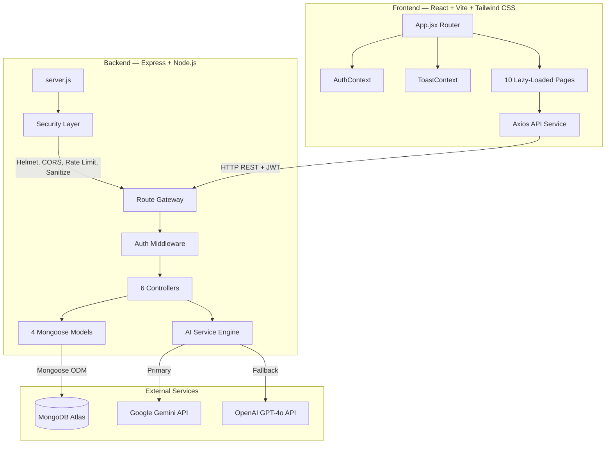
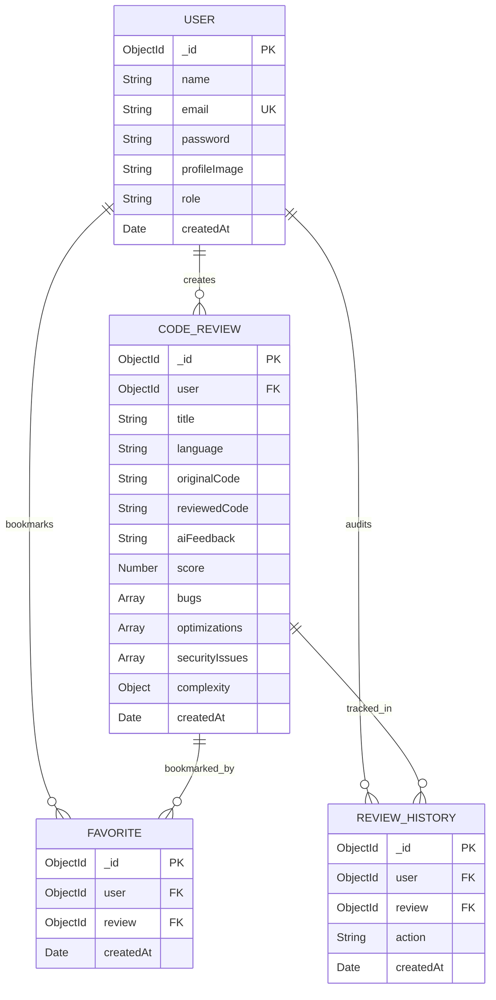

# 🛠️ AI-Powered Code Review Tool

A production-grade full-stack **MERN** application that uses **Google Gemini 1.5 Pro** or **OpenAI GPT-4o** to automatically review, analyze, score, and optimize source code with actionable suggestions, security audits, and quality scoring.

[](https://nodejs.org)
[](https://react.dev)
[](https://mongodb.com)
[](https://expressjs.com)
[](https://tailwindcss.com)

---

## ✨ Key Features

| Feature | Description |
|:---|:---|
| 🤖 **Dual AI Engine** | Google Gemini 1.5 Pro + OpenAI GPT-4o with automatic fallback |
| 📝 **Code Submission** | Paste code or upload source files (.py, .java, .js, .ts, .cpp, .cs, .go) |
| 📊 **12-Metric Analysis** | Summary, Quality, Security, Performance, Bugs, Readability, Complexity, Score |
| 🔍 **Advanced Search** | Full-text search, language filter, score range, date range, sorting |
| ⭐ **Favorites System** | Bookmark and manage favorite code reviews |
| 📈 **Analytics Dashboard** | 7 metric cards, bar charts, pie charts, timeline trends |
| 📄 **Report Export** | Download reports as PDF, DOCX, or Markdown |
| 👤 **Profile Management** | Edit profile, upload avatar, change password, delete account |
| 🛡️ **Admin Dashboard** | User management, system stats, review inspection |
| 🔒 **Enterprise Security** | Helmet, Rate Limiting, JWT, XSS, CORS, MongoDB Injection Prevention |
| ⚡ **Performance Optimized** | Gzip compression, caching, code splitting, lazy loading |
| 🔔 **Toast Notifications** | Success, error, loading, and review-complete toast system |

---

## 🏗️ Architecture Diagram



---

## 🗄️ Database ER Diagram



---

## 📋 External Requirements (What You Need to Provide)

### 1. 🟢 Node.js (Runtime)

| Item | Details |
|:---|:---|
| **Version** | `v18.x` or higher (recommended `v22+`) |
| **Download** | [https://nodejs.org](https://nodejs.org) |
| **Verify** | Run `node -v` and `npm -v` in terminal |

### 2. 🍃 MongoDB (Database)

**Option A: Local Installation** — [Download MongoDB Community](https://www.mongodb.com/try/download/community)  
**Option B: MongoDB Atlas (Free Tier)** — [Sign up at mongodb.com/cloud/atlas](https://www.mongodb.com/cloud/atlas)

> [!IMPORTANT]
> If using Atlas: whitelist your IP in **Network Access** and create a database user in **Database Access**.

### 3. 🤖 AI API Key (At Least One Required)

| Provider | Where to Get | Model | Cost |
|:---|:---|:---|:---|
| **Google Gemini** (Recommended) | [aistudio.google.com/apikey](https://aistudio.google.com/apikey) | `gemini-1.5-pro` | Free tier (15 req/min) |
| **OpenAI** | [platform.openai.com/api-keys](https://platform.openai.com/api-keys) | `gpt-4o` | Pay-as-you-go |

### 4. 🔐 JWT Secret Key

Generate a secure random key:
```bash
node -e "console.log(require('crypto').randomBytes(64).toString('hex'))"
```

---

## ⚙️ Environment Variables

Create `server/.env`:

```env
PORT=5000
MONGODB_URI=mongodb://127.0.0.1:27017/ai-code-reviewer
JWT_SECRET=<your_64_byte_random_hex_key>
GEMINI_API_KEY=<your_gemini_api_key>
OPENAI_API_KEY=<your_openai_api_key>
CLIENT_URL=http://localhost:5173
```

> [!CAUTION]
> Never commit `.env` to Git. It contains sensitive API keys and secrets.

---

## 🚀 How to Run

```bash
# 1. Clone
git clone <your-repo-url>
cd AI-Powered-code-review-tool

# 2. Install server dependencies
cd server && npm install

# 3. Install client dependencies
cd ../client && npm install

# 4. Configure server/.env (see above)

# 5. Start backend (Terminal 1)
cd server && npm run dev

# 6. Start frontend (Terminal 2)
cd client && npm run dev

# 7. Open browser
# http://localhost:5173
```

---

## 📡 API Documentation

**Base URL**: `http://localhost:5000/api`  
**Auth Header**: `Authorization: Bearer <JWT_TOKEN>`

### Auth Endpoints

| Method | Endpoint | Body | Auth |
|:---|:---|:---|:---:|
| `POST` | `/auth/register` | `{ name, email, password }` | ❌ |
| `POST` | `/auth/login` | `{ email, password }` | ❌ |
| `GET` | `/auth/me` | — | ✅ |
| `POST` | `/auth/logout` | — | ✅ |

### Review Endpoints

| Method | Endpoint | Body / Query | Auth |
|:---|:---|:---|:---:|
| `POST` | `/reviews` | `{ title, language, codeSnippet }` | ✅ |
| `POST` | `/reviews/upload-file` | `FormData: codeFile, title, language` | ✅ |
| `GET` | `/reviews` | `?search=&language=&minScore=&maxScore=&sort=&page=&limit=` | ✅ |
| `GET` | `/reviews/analytics` | — | ✅ |
| `GET` | `/reviews/:id` | — | ✅ |
| `DELETE` | `/reviews/:id` | — | ✅ |

### Favorites Endpoints

| Method | Endpoint | Body | Auth |
|:---|:---|:---|:---:|
| `POST` | `/favorites/toggle` | `{ reviewId }` | ✅ |
| `GET` | `/favorites` | `?page=&limit=` | ✅ |
| `DELETE` | `/favorites/:id` | — | ✅ |

### User Endpoints

| Method | Endpoint | Body | Auth |
|:---|:---|:---|:---:|
| `PUT` | `/users/profile` | `{ name, email }` | ✅ |
| `PUT` | `/users/avatar` | `FormData: avatar` | ✅ |
| `PUT` | `/users/password` | `{ currentPassword, newPassword }` | ✅ |
| `DELETE` | `/users/account` | — | ✅ |

### Report Endpoints

| Method | Endpoint | Response | Auth |
|:---|:---|:---|:---:|
| `GET` | `/reports/:id/pdf` | PDF file download | ✅ |
| `GET` | `/reports/:id/docx` | DOCX file download | ✅ |

### Admin Endpoints (Role: admin)

| Method | Endpoint | Query | Auth |
|:---|:---|:---|:---:|
| `GET` | `/admin/stats` | — | ✅ Admin |
| `GET` | `/admin/users` | `?search=&page=&limit=` | ✅ Admin |
| `DELETE` | `/admin/users/:userId` | — | ✅ Admin |
| `GET` | `/admin/reviews` | `?search=&page=&limit=` | ✅ Admin |

---

## 📁 Project Structure

```
AI-Powered-code-review-tool/
├── client/                          # React Frontend (Vite)
│   └── src/
│       ├── components/              # AdminRoute, FileUploadZone, ProtectedRoute, layout/
│       ├── context/                 # AuthContext, ToastContext
│       ├── pages/                   # 10 route pages (lazy-loaded)
│       ├── services/api.js          # Axios client with JWT interceptor
│       └── App.jsx                  # Root router with Suspense
│
├── server/                          # Express Backend
│   └── src/
│       ├── config/db.js             # MongoDB connection
│       ├── controllers/             # auth, review, user, favorite, admin, report
│       ├── middleware/              # auth, admin, cache, error, security, upload
│       ├── models/                  # User, CodeReview, Favorite, ReviewHistory
│       ├── routes/                  # 6 route files + index.js gateway
│       ├── services/ai.service.js   # Gemini + OpenAI + mock fallback
│       └── utils/                   # ApiError, ApiResponse, generateToken, prompts
│   └── tests/                       # Jest + Supertest integration tests
│
└── README.md
```

---

## 🧪 Running Tests

```bash
cd server
npm test
```

> Tests use mock AI responses and require a running MongoDB instance.

---

## ✅ Quick Checklist

| # | Requirement | Status |
|:---|:---|:---:|
| 1 | Node.js v18+ installed | ⬜ |
| 2 | MongoDB running (local or Atlas) | ⬜ |
| 3 | `MONGODB_URI` set in `.env` | ⬜ |
| 4 | `JWT_SECRET` set in `.env` | ⬜ |
| 5 | At least one AI API key set | ⬜ |
| 6 | `npm install` in both `server/` and `client/` | ⬜ |
| 7 | Backend running on port `5000` | ⬜ |
| 8 | Frontend running on port `5173` | ⬜ |

---

## 🔮 Future Enhancements

- 🔄 JWT Refresh Token Rotation
- 📦 Redis Caching for multi-instance deployments
- 🔌 WebSocket real-time notifications (Socket.io)
- 📋 Job Queue (BullMQ) for async AI processing
- 🎨 Syntax Highlighting (Prism.js / CodeMirror)
- 🐳 Docker containerization
- 🔁 CI/CD pipeline (GitHub Actions)
- 📧 Email service (SendGrid) for password reset
- 👥 Team workspaces with shared review boards
- 🐙 GitHub webhook integration for automatic PR reviews
- 📱 React Native mobile companion app
- 🧩 VS Code extension for inline AI reviews
